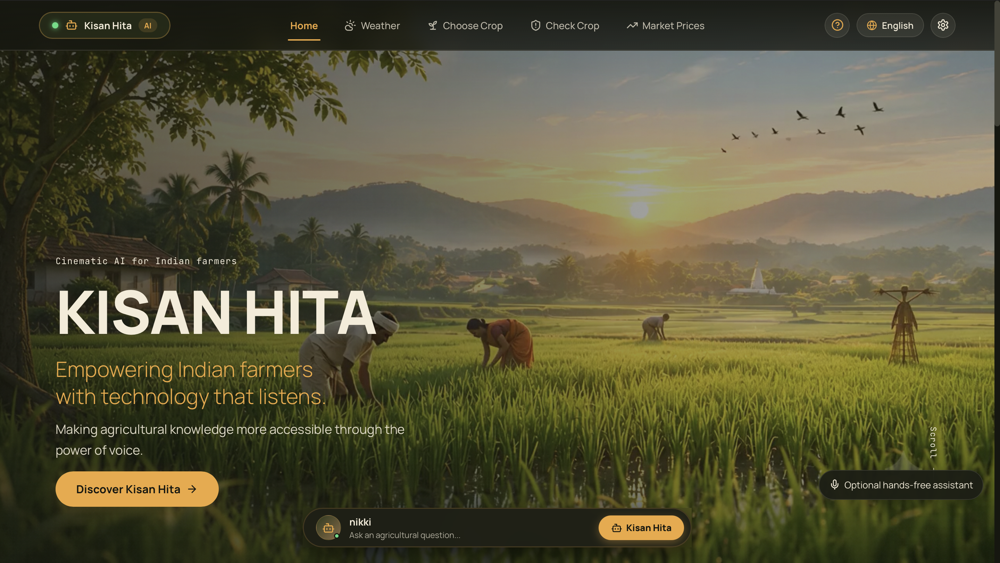
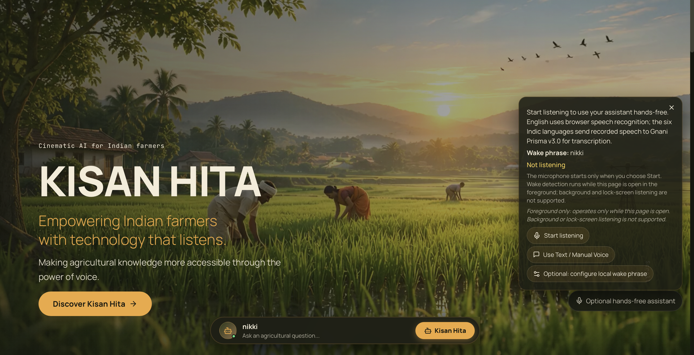
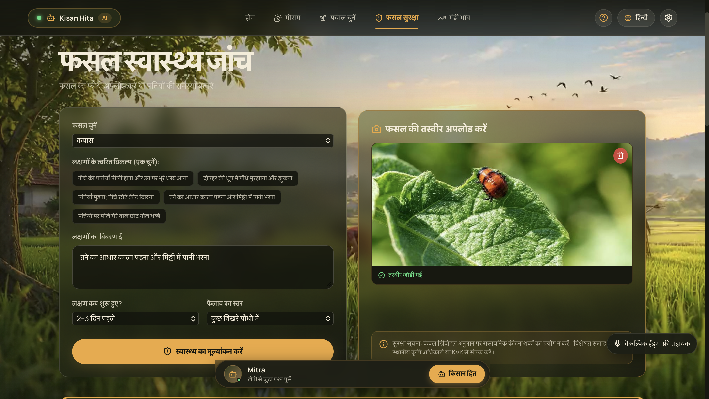
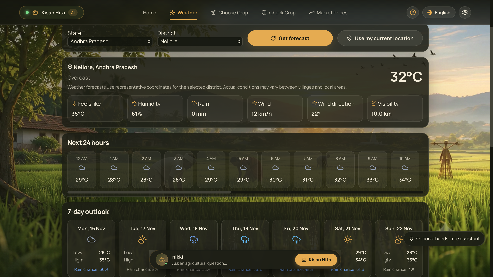

<h1 align="center">🌾 KISAN HITA</h1>

<h3 align="center">A Voice-First, Multilingual AI Assistant for Indian Farmers</h3>

<p align="center">
  <strong>Bridging the gap between farmers and accessible agricultural information through conversational AI and voice technology.</strong>
</p>

<p align="center">
  <a href="https://kisan-hita-2uou.onrender.com">
    
  </a>
</p>

<p align="center">
  
  
  
  
  
  
</p>

<p align="center">
  <strong>Gnani Prisma v3.0</strong> — Speech-to-Text (STT)
  &nbsp; | &nbsp;
  <strong>Gnani Timbre v3.0</strong> — Text-to-Speech (TTS)
</p>

---

## 🌟 1. Project Overview

Agricultural information is not always easy to access. Language barriers, text-heavy interfaces, fragmented digital services, and limited familiarity with technology can make it difficult for farmers to find and understand information relevant to their needs.

**Kisan Hita** is a voice-first, multilingual AI assistant designed to make agricultural information more accessible to Indian farmers.

The platform brings together conversational AI, regional-language interaction, crop guidance, crop-health assistance, and agricultural information through a simplified interface.

Rather than treating AI as a replacement for agricultural expertise, Kisan Hita is designed as a supporting tool that helps farmers communicate their questions and understand available information more easily.

### 🎯 Project Objectives

- Make agricultural information easier to access through natural conversation.
- Reduce dependence on text-heavy interactions through voice capabilities.
- Support farmers in their preferred regional languages.
- Provide accessible AI-assisted crop guidance and crop-health information.
- Build a practical, responsive interface around real agricultural workflows.
- Maintain transparency about AI limitations and external data sources.

## 🖥️ 2. Application Showcase

The following sections introduce the application's interface and explain the purpose of each feature alongside its corresponding screenshot.

### 🏠 Home — A Central Starting Point

The home page introduces Kisan Hita and brings its primary agricultural tools together in one place. Its layout is designed to help users understand the platform and navigate to relevant features without unnecessary complexity.

<p align="center">
  
</p>

### ✨ Explore the Platform

The feature overview presents the application's key capabilities and gives users a clear starting point for exploring its agricultural tools.

<p align="center">
  
</p>

### 🤖 AI Assistant — Conversational Agricultural Support

The AI Assistant provides a conversational interface where users can ask questions and receive AI-generated responses. The experience supports text and voice interaction, with multilingual support across seven languages.

The goal is to make interaction more natural and reduce the effort required to navigate traditional text-based interfaces.

<p align="center">
  
</p>

### 🎙️ Hands-Free Assistant — Voice-Driven Interaction

The Hands-Free Assistant explores a more accessible way to interact with the application through voice. Users can activate the feature, grant microphone permission, and interact using recognized speech.

The current implementation uses browser speech-recognition capabilities and transcript-based phrase detection. It requires user activation and an open application page; it is not a background acoustic wake-word detection system.

<p align="center">
  
</p>

### 🌱 Choose My Crop — AI-Assisted Crop Recommendations

The Crop Advisor provides AI-assisted crop recommendations based on information supplied by the user. The recommendations are intended as guidance and should not be treated as scientifically verified guarantees.

<p align="center">
  
</p>

### 🌱 Check My Crop — AI-Assisted Crop Health

The crop-health interface allows users to submit crop images for AI-assisted analysis of possible visible issues.

The feature is intended to help users understand potential crop-health concerns and identify when further expert assessment may be needed. Its output is informational, not a guaranteed diagnosis or an independent prescription for pesticide or fertilizer treatment.

<p align="center">
  
</p>

### 📊 Market Prices — Agricultural Price References

The Market Prices interface provides a dedicated space to explore available agricultural market-price reference information.

The currently configured dataset is reference/demo data, not a verified live AGMARKNET feed. It should not be interpreted as official real-time market pricing.

<p align="center">
  
</p>

### 🌦️ Weather Dashboard — Interface Design Reference

The following image is retained as a visual reference from the earlier Weather Dashboard design. Weather functionality is not listed as an active feature in the current project scope.

<p align="center">
  
</p>

---

## ✨ 3. Core Capabilities

| Capability | Description |
|---|---|
| Multilingual Assistant | Conversational AI interaction across seven supported languages |
| Voice Interaction | Speech input and spoken-response capabilities |
| Hands-Free Interaction | Optional, user-activated voice interaction |
| Crop Advisor | AI-assisted crop recommendations based on user-provided information |
| Crop Health | Image-based assistance for understanding possible crop issues |
| Market Prices | Agricultural market-price reference information |
| Responsive Interface | Layouts designed for desktop and mobile screens |

## 🌍 4. Multilingual Support

Kisan Hita supports seven languages to make interaction more accessible to users from different linguistic backgrounds.

| Language | Native Name |
|---|---|
| Telugu | తెలుగు |
| English | English |
| Hindi | हिन्दी |
| Tamil | தமிழ் |
| Kannada | ಕನ್ನಡ |
| Malayalam | മലയാളം |
| Marathi | मराठी |

The localization approach prioritizes familiar, conversational expressions rather than relying on overly formal or word-for-word translations.

The goal is to make the complete application experience understandable, including navigation, controls, and feature interactions.

## 🎧 5. Gnani AI Voice Technology

Kisan Hita incorporates integration adapters for two Gnani AI speech technologies: Prisma for speech recognition and Timbre for speech generation.

### 🗣️ Gnani Prisma v3.0 — Speech-to-Text

Prisma is the intended speech-recognition provider. Its integration adapter handles speech-to-text requests and makes recognized text available for further processing.

### 🔊 Gnani Timbre v3.0 — Text-to-Speech

Timbre is the intended speech-generation provider. Its integration adapter handles text-to-speech requests.

The selected voice configuration is **Vasudha** across all seven supported application languages.

### 🔄 Intended Voice Processing Flow

<div align="center">

```text
┌──────────────────────────────┐
│       Farmer's Voice         │
└──────────────┬───────────────┘
               ↓
┌──────────────────────────────┐
│     Gnani Prisma v3.0        │
│        Speech-to-Text        │
└──────────────┬───────────────┘
               ↓
┌──────────────────────────────┐
│       Recognized Text        │
└──────────────┬───────────────┘
               ↓
┌──────────────────────────────┐
│    Google Gemini             │
│    AI Response Generation    │
└──────────────┬───────────────┘
               ↓
┌──────────────────────────────┐
│        Response Text         │
└──────────────┬───────────────┘
               ↓
┌──────────────────────────────┐
│      Gnani Timbre v3.0       │
│        Text-to-Speech        │
└──────────────┬───────────────┘
               ↓
┌──────────────────────────────┐
│       Spoken Response        │
└──────────────────────────────┘
```

</div>
### Integration Readiness

| Component | Implementation Status |
|---|---|
| Prisma v3.0 adapter | Implemented |
| Timbre v3.0 adapter | Implemented |
| Vasudha voice configuration | Configured for seven languages |
| Live Gnani connectivity | Not independently verified |
| Live Gnani requests | Disabled by default |

**Important:** Implementing an integration adapter does not establish that the external provider is connected successfully. Live Gnani connectivity must be tested separately with valid credentials.

### Gnani Environment Variables

```env
GNANI_LIVE_ENABLED=false
GNANI_PRISMA_ENABLED=false
GNANI_TIMBRE_ENABLED=false
GNANI_API_KEY=
```

Live provider requests should only be enabled after the credentials, configuration, and actual API responses have been verified.

## 🧠 6. AI Reasoning with Google Gemini

Google Gemini is configured as a separate AI reasoning provider for assistant response generation.

### Configuration

```env
GEMINI_ENABLED=true
GEMINI_API_KEY=your_gemini_api_key
GEMINI_MODEL=gemini-3.1-flash-lite
```

A valid API key is required when Gemini is enabled.

The application separates reasoning from speech processing:

- **Gemini:** AI reasoning and response generation.
- **Prisma:** Intended speech recognition.
- **Timbre:** Intended speech generation.

API keys must remain in backend environment variables and must never be exposed in frontend code or committed to source control.

## 🏗️ 7. System Architecture

Kisan Hita follows a frontend-and-backend architecture that separates the user interface, application services, AI integrations, and supporting data.

```text
KISAN HITA
│
├── Frontend
│   ├── React
│   ├── TypeScript
│   ├── Vite
│   ├── Application Components
│   ├── Multilingual Interface
│   └── Voice Interaction
│
├── Backend
│   ├── Python
│   ├── FastAPI
│   ├── Assistant Services
│   ├── Crop Advisor Services
│   ├── Crop Health Services
│   ├── Market Price Services
│   └── Voice Integration Services
│
├── AI and Voice Providers
│   ├── Google Gemini
│   ├── Gnani Prisma v3.0
│   └── Gnani Timbre v3.0
│
└── Supporting Data
    ├── SQLite
    ├── Agricultural Reference Data
    └── Application Configuration
```

### 🛠️ Technology Stack

| Layer | Technologies |
|---|---|
| Frontend | React, TypeScript |
| Build Tool | Vite |
| Backend | Python, FastAPI |
| Database | SQLite |
| AI Reasoning | Google Gemini |
| Speech-to-Text Integration | Gnani Prisma v3.0 |
| Text-to-Speech Integration | Gnani Timbre v3.0 |
| Browser Voice Capabilities | Web Speech APIs |

## 🔌 8. Backend API

The backend exposes application endpoints for its primary services.

| Endpoint | Purpose |
|---|---|
| `GET /api/health` | Backend health check |
| `GET /api/ready` | Application readiness check |
| `POST /api/assistant/chat` | Assistant conversation |
| `POST /api/crop-advisor/recommend` | Crop recommendations |
| `POST /api/crop-health/diagnose` | Crop-health image analysis |
| `GET/POST /api/market-prices/search` | Market-price search |
| `POST /api/voice/stt/upload` | Speech-to-text upload |
| `POST /api/voice/tts` | Text-to-speech generation |

The exact request parameters, validation rules, and response schemas can be inspected through the FastAPI documentation.

**Local API documentation:**

`http://127.0.0.1:8000/docs`

An available backend endpoint does not automatically mean its external provider is live. Provider-dependent operations require valid credentials and successful connectivity.

## 🚀 9. Local Development Setup

### Prerequisites

Install the following:

- Python 3
- Node.js and npm
- Git

### Step 1 — Clone the Repository

Use the actual V2 repository URL:

```bash
git clone <YOUR_KISAN_HITA_V2_REPOSITORY_URL>
cd <YOUR_REPOSITORY_FOLDER>
```

### Step 2 — Create the Python Environment

From the project root:

```bash
python3 -m venv .venv
source .venv/bin/activate
python3 -m pip install -r requirements.txt
```

### Step 3 — Install Frontend Dependencies

```bash
cd frontend
npm ci
cd ..
```

### Step 4 — Configure Environment Variables

Create or update the backend environment file using the project's existing configuration.

Example:

```env
GEMINI_ENABLED=true
GEMINI_API_KEY=your_gemini_api_key
GEMINI_MODEL=gemini-3.1-flash-lite

GNANI_LIVE_ENABLED=false
GNANI_PRISMA_ENABLED=false
GNANI_TIMBRE_ENABLED=false
GNANI_API_KEY=
```

Do not publish real credentials or commit `.env` files.

### Step 5 — Start the Application

From the project root:

```bash
./start.sh
```

The startup script is the project's convenience entry point for running the application.

Open the frontend address printed by the startup process.

### Backend Health Check

```text
http://127.0.0.1:8000/api/health
```

### Interactive API Documentation

```text
http://127.0.0.1:8000/docs
```

## 🧪 10. Testing and Production Build

### Backend Tests

From the project root:

```bash
python3 backend/run_tests.py
```

### Frontend Tests

```bash
cd frontend
npm test
```

### Production Build

```bash
npm run build
```

### Previously Recorded Validation Results

| Test Area | Previously Recorded Result |
|---|---:|
| Backend tests | 194/194 passed |
| Frontend tests | 217/217 passed |
| Animation tests | 24/24 passed |
| Frontend production build | Successful |

These are previously recorded local validation results. They should not be interpreted as confirmation that every external provider or deployed integration is currently operational.

## 🔐 11. Security and Responsible AI

Agricultural technology must be useful without creating unnecessary risks for farmers.

Kisan Hita follows these principles:

- **Credential protection:** External API keys are kept on the backend.
- **Controlled integrations:** Optional AI and voice providers are controlled through environment configuration.
- **Transparent AI assistance:** AI-generated information is presented as assistance, not guaranteed professional advice.
- **Agricultural safety:** Crop-health results are preliminary and should not replace qualified diagnosis.
- **No independent treatment prescriptions:** The AI is not intended to independently prescribe pesticides or other high-risk treatments.
- **Data transparency:** Reference datasets are not presented as verified live official data.
- **User-controlled microphone access:** Hands-free interaction requires explicit activation and microphone permission.

## 📁 12. Project Structure

The repository separates frontend and backend responsibilities, with supporting documentation, configuration, and tests.

```text
KISAN_HITA/
│
├── backend/
│   ├── Application and API services
│   ├── AI and voice integrations
│   ├── Data and configuration
│   └── Tests
│
├── frontend/
│   ├── src/
│   ├── public/
│   ├── package.json
│   └── vite.config.ts
│
├── docs/
│   └── screenshots/
│       ├── home.png
│       ├── home-features.png
│       ├── assistant.png
│       ├── hands-free-assistant.png
│       ├── crop-recommendations.png
│       ├── check-my-crop.png
│       ├── market-prices.png
│       └── weather-dashboard.png
│
├── requirements.txt
├── start.sh
└── README.md
```

The structure above is a high-level overview. Actual filenames and subdirectories should match the repository.

## 📌 Project Details

| Attribute | Details |
|---|---|
| Project Name | Kisan Hita V2 |
| Domain | Agriculture Technology |
| Category | Artificial Intelligence / Generative AI |
| Frontend | React, TypeScript, Vite |
| Backend | Python, FastAPI |
| AI Reasoning | Google Gemini |
| Voice Technology | Gnani Prisma v3.0, Timbre v3.0 |
| Language Support | 7 Indian languages |
| Live Application | [kisan-hita-2uou.onrender.com](https://kisan-hita-2uou.onrender.com) |
| Challenge | Gnani AI Great Indian AI Internship Challenge |

<p align="center">
  <strong>🌾 KISAN HITA</strong><br />
  <em>Making agricultural information more accessible through voice-first AI.</em>
</p>
